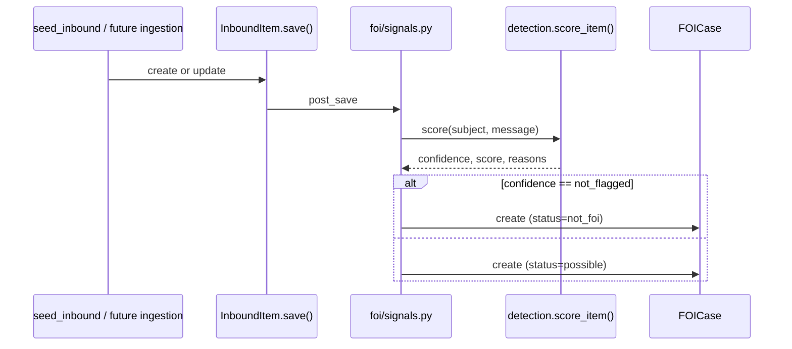
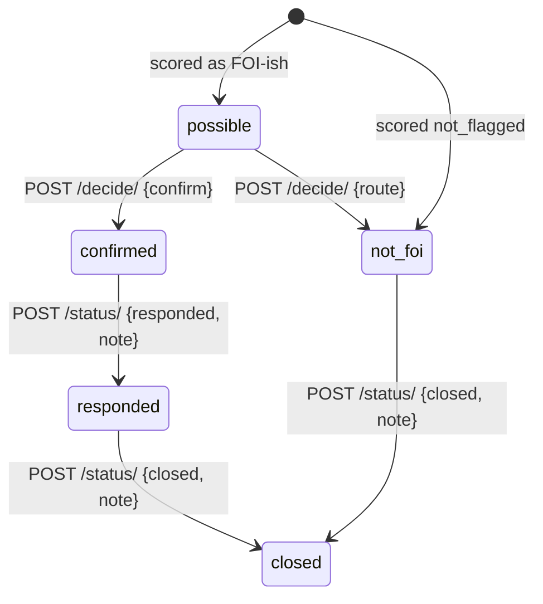

# How FOI tracking works

Covers the two tickets built into `backend/foi/`: automatically flagging inbound items that look like
FOI requests (with a reason), and tracking confirmed requests through to a response, with deadlines and
a history of actions taken.

## One app, one case per item

`FOICase` is a `OneToOneField` onto `InboundItem` ([models.py](../backend/foi/models.py)) - every
inbound item gets exactly one. Every message needs someone to close it out eventually, FOI or not, so
an item the detector doesn't flag lands straight on `not_foi` (confidence `not_flagged`) rather than
having no case at all - it still needs an owner and a final close, it just skips the "is this FOI?"
review step.

`FOIAction` is an append-only history on a case: every status change and every freeform note a person
adds, each with who did it and when.

## From inbound item to case: the signal

A `post_save` signal on `InboundItem` ([signals.py](../backend/foi/signals.py), connected in
[apps.py](../backend/foi/apps.py)) runs on every save, so this works the same way whether an item comes
from the CSV seed, a future real ingestion path, or someone editing it in `/admin/`.

Already-existing items (from before this feature shipped) don't get a case automatically, since the
signal only fires on a save. `manage.py rescan_foi` backfills those - it's wired into `make seed`, after
`seed_inbound`.

## The detector: `foi/detection.py`

`score_item(subject, message)` runs a small scoring checklist: a set of phrases that suggest FOI
("freedom of information", "please provide", "how many", ...) each add points, a few that suggest the
opposite (an invoice, a routine service question) subtract points. The phrase lists live in one place in
that file so they can be tuned without touching the scoring logic.

The score maps to a confidence tier - `high`, `medium`, `unclear`, or `not_flagged` - with two override
rules: an explicit "Freedom of Information" mention always reaches at least `medium` even if other
signals look like supplier mail, and anything that looks like supplier/admin mail without an explicit
mention is never flagged, regardless of score. Matching is word-boundary based (`total` doesn't match
inside `totally`), except one deliberately fuzzy phrase matching any `since 20xx` year mention.

The reasons shown to a reviewer are just the labels of whichever checks fired, e.g. "Asks for recorded
information", "Covers a time period".

## The deadline: `foi/dates.py`

The statutory FOI deadline is 20 working days from the date of receipt. `calculate_deadline()`:

1. Rolls a weekend/bank-holiday received date forward to the next working day (that's the date of
   receipt).
2. Counts 20 working days forward from there, skipping weekends and bank holidays.

Bank holidays are a hand-typed England & Wales list covering 2025-2027 (`BANK_HOLIDAYS` /
`LAST_COVERED_DATE` in that file). Scotland/Northern Ireland holidays aren't excluded, which only ever
makes a computed deadline earlier than the true legal one, never later. A deadline is `None` ("needs
review") when the received date is unknown or the computed due date would fall past the holiday list's
coverage - extend the list rather than assume anything in that gap.

A naive (timezone-unaware) `received_at` - the one way that can happen is typing a date into
`/admin/`, which has no timezone widget - is treated as local wall-clock time, the same assumption
[inbound/dates.py](../backend/inbound/dates.py) makes for the CSV path.

## The case lifecycle

Transitions are forward-only and audited: `/decide/` and `/status/` lock the case row for the whole
read-check-write (`select_for_update()` inside `transaction.atomic()`), so two concurrent requests on the
same case can't both pass the status check before either writes. Every transition writes an `FOIAction`
row alongside the status change.

`is_overdue` is computed, not stored: the deadline has passed and the status isn't `closed`. Note that a
`responded` case still counts as overdue until it's `closed` - that's deliberate (a late response is
still late until the case is actually closed out), not a bug. A `not_foi` case is never overdue, since
there's no FOI deadline to miss - but it still needs closing, see the lifecycle diagram above.

## What each endpoint does

All of `/api/foi/` requires sign-in, like the rest of the API, and every signed-in officer sees every
case - there are no per-user inboxes, same reasoning as `/api/inbound/`.

| Endpoint | Does |
| --- | --- |
| `GET /api/foi/` | list every case, optionally `?status=possible` etc. |
| `GET /api/foi/<id>/` | one case, with its full action history |
| `PATCH /api/foi/<id>/` | assign or clear the `owner` - the only field this accepts |
| `POST /api/foi/<id>/decide/` | `{decision: confirm}` or `{decision: route, department}` - only while `status=possible` |
| `POST /api/foi/<id>/status/` | `{status: responded\|closed, note}` - note required, forward-only |
| `POST /api/foi/<id>/actions/` | `{note}` - a freeform progress note, no status change |

## Known, deliberate limitations

- **No SAR workflow.** The detector flags when a request looks like it's actually about the sender's own
  data (`suggest_sar`), and that's always recorded on the case now that every item gets one - but
  nothing in the UI surfaces it yet, since neither ticket asked for subject-access-request tracking.
- **No manual flag/route.** Earlier there was a path for an officer to flag or route an item the
  detector hadn't cased yet; once every item always gets a case immediately, there's never an item
  without one for that to target, so it was removed rather than left unreachable.
- **Bank holidays are England & Wales only**, 2025-2027. See `foi/dates.py` for how to extend the list.
- **Status moves forward only.** There's no "un-confirm" or reopen-a-closed-case path.
- **The Django admin is not the intended workflow.** It exists for inspecting data; `FOICaseAdmin`
  populates `created_by` on an inline-added action, but the real officer workflow is the API.
